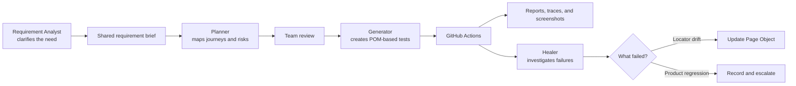

# Playwright QA Workflow

[](https://github.com/terese-emel/qa-playwright/actions/workflows/playwright.yml)

This repository is a portfolio project showing how a team can build and maintain reliable browser tests—not just write a few scripts that click through a page. It includes a small, self-contained grocery price comparison journey so the workflow can be seen in action without relying on a live customer system.

It demonstrates a complete quality workflow around Playwright: clarify the requirement, plan the risks, build maintainable tests, review failures honestly, and keep the work safe and traceable.

## What problem does it solve?

Browser tests often become difficult to maintain when they mix product decisions, selectors, test data, setup, and debugging logic in the same file. They also become unreliable when requirements are unclear or when a failing test is “fixed” by weakening its assertion.

This project addresses those problems by giving each responsibility a clear place:

- Product needs are clarified before test planning begins.
- Plans explain risks, roles, edge cases, ownership, and open questions.
- Page Objects and fixtures keep reusable browser details out of scenarios.
- Tests use synthetic data and stable accessible locators.
- Failure investigation distinguishes a stale locator from a real product regression.
- Requirement links and CI artifacts make the work easier to review.

## How the workflow is structured



The full design is documented in [`docs/test-architecture.md`](docs/test-architecture.md).

Tool-specific guidance is in [`docs/tool-best-practices.md`](docs/tool-best-practices.md) and is applied by the Requirement Analyst, Planner, Generator, and Healer workflow.

The most important team rule is simple: a test repair must never quietly weaken what the test is meant to prove.

## Technology

- Playwright Test and TypeScript for browser automation
- Page Object Model, fixtures, and accessible locators for maintainability
- GitHub Actions for repeatable CI
- ESLint and Prettier for code quality
- Python scripts for test-data safety and requirement traceability
- Shared Jira CLI skill in `qa-orchestrator/.agents/skills/jira-acli/` for reading requirements and reporting approved updates
- Portable Agent Skills under [`.agents/skills/`](.agents/skills/)

## Project structure

```text
qa-playwright/
├── agents/                 # Team roles and boundaries
├── .agents/skills/         # Portable, reusable agent skills
├── pages/                  # Page Objects and stable locators
├── fixtures/               # Shared Playwright setup
├── tests/                  # Scenario intent and assertions
├── coverage/               # Requirement links, plans, and reports
├── config/                 # Testing conventions
├── docs/                   # Architecture and team guidance
├── scripts/                # Validation and flakiness utilities
└── .github/workflows/      # CI, security, and coverage checks
```

## Run it locally

Requirements: Node.js, npm, and a Playwright-supported browser.

```bash
npm install
npx playwright install chromium
npm run lint
npm run format:check
npm run test:playwright
```

The smoke test uses a deterministic synthetic page, so it does not depend on public internet availability or a third-party application.

## What is tested today?

The current suite is intentionally a foundation rather than a pretend production regression suite:

| Scenario | What it demonstrates |
| --- | --- |
| Grocery price comparison | A shopper can compare prices for a named item |
| Missing item guidance | The user receives a clear message instead of an empty result |
| Accessible heading and controls | Semantic labels, roles, and a live status message are used |
| Failure evidence | CI-ready HTML, JUnit, trace, and screenshot configuration |

The next layer would add price freshness, unavailable stores, boundary values, authentication, permissions, and multi-role journeys.

The portfolio expansion uses Sauce Demo for a public, repeatable web journey and The Internet for focused browser edge cases. The local grocery comparison flow remains deterministic so pull requests do not depend entirely on an external site.

The Sauce Demo journey is opt-in: set `RUN_LIVE_DEMO=true`, `DEMO_USER`, and `DEMO_PASSWORD`, then run `npm run test:live-demo`. Pull requests continue to use deterministic local tests by default.

## Evidence and live demo

There is no separate hosted product UI in this repository. The live demonstration is the [GitHub Actions workflow history](https://github.com/terese-emel/qa-playwright/actions). Failed runs are configured to retain reports, traces, and screenshots for investigation.

The repository also includes Mermaid architecture diagrams and the configuration needed to produce CI evidence. The local grocery comparison journey is deterministic; the Sauce Demo journey is opt-in and clearly labelled rather than presented as a fake product demo.

## Team agents and skills

The repository separates team responsibilities so work can happen in parallel without losing context:

| Role | Responsibility |
| --- | --- |
| Requirement Analyst | Clarifies the product need, risks, roles, and unanswered questions |
| Planner | Turns an approved brief into a risk-based test plan |
| Generator | Builds Page Object-based tests from an approved plan |
| Healer | Investigates failures without hiding regressions |
| Flaky analyzer | Looks for patterns in unpredictable test results |
| Coverage checker | Confirms important product needs have named tests |
| Security validator | Helps keep personal data, production data, and secrets out |

Portable versions of the QA capabilities live under [`.agents/skills/`](.agents/skills/). Shared cross-tool skills, including `jira-acli` and `skill-creator`, live in the [`qa-orchestrator`](https://github.com/terese-emel/qa-orchestrator) repository. The Jira skill can read stories and acceptance criteria for the Requirement Analyst; any Jira write—comment, edit, transition, assignment, or bug creation—requires explicit approval.

The lightweight [`agent-router`](.agents/skills/agent-router/SKILL.md) selects one primary responsibility at a time. Small handoff files in [`coverage/templates/`](coverage/templates/) let agents share context without carrying full conversations or logs.

## Safety and review

All examples use synthetic data. Secrets, credentials, personal information, production records, and unredacted traces do not belong in this repository or in Jira updates.

Plans and generated changes are reviewed by the team before they are committed. The agents support engineering judgment; they do not replace product decisions, code review, security review, or the native Playwright test runner.

## Related project

The separate [`qa-orchestrator`](https://github.com/terese-emel/qa-orchestrator) repository can dispatch this workflow alongside the other QA repositories and report their combined status. This repository remains independently runnable and owns its own tests, configuration, dependencies, and CI.
