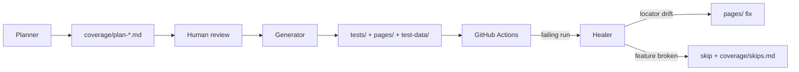
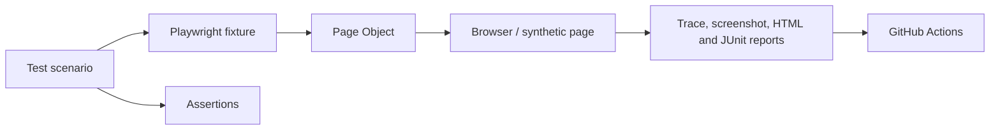

# qa-playwright

[](https://github.com/terese-emel/qa-playwright/actions/workflows/playwright.yml)

Independent playwright QA automation repository. Includes its own tests, dependencies, AI instructions, and GitHub Actions. No dependency on the other repositories.

## Local usage

```bash
npm install
npx playwright install chromium

npm run test:playwright
```

GitHub Actions: `.github/workflows/playwright.yml`.

The current smoke test uses a deterministic synthetic page so local and CI results are not dependent on public internet availability.

## Agent workflow: Planner → Generator → Healer

Tests are produced and maintained by three agents, each with a hard boundary. See [`docs/test-architecture.md`](docs/test-architecture.md) for the full description.

- **Planner** — explores the app, writes a Markdown test plan to `coverage/`. No code is generated; a human approves the plan first.
- **Generator** — turns an approved plan into Page Object-based Playwright specs, validating selectors against the live app before writing them.
- **Healer** — fixes locator drift on failing tests. If the feature itself is broken it skips the test and logs the regression rather than weakening the assertion.

The one rule agents cannot break: a "fix" that quietly weakens an assertion is a hidden bug, not a repair.



## Agent mode: CLI vs MCP

CI runs use **CLI mode** by default (snapshots saved to disk, ~27K tokens per task). For live exploration and debugging, set `PLAYWRIGHT_AGENT_MODE=mcp` (~114K tokens — about 4× more).

```bash
# default — lean CI runs
npm run test:playwright

# MCP mode — live page state in agent context
PLAYWRIGHT_AGENT_MODE=mcp npx playwright test
```

## Portfolio overview

This project shows how I approach browser automation when the goal is a test suite that remains understandable as it grows. The smoke test is intentionally small, but it already uses a Page Object, a fixture, stable accessible locators, requirement traceability, and CI-friendly reporting. In other words, the test describes user intent while the reusable framework code owns setup and selectors.

There is no separate product UI to demo here—the project itself is the QA workflow. You can see it running in the [GitHub Actions history](https://github.com/terese-emel/qa-playwright/actions), where failed runs retain reports, traces, and screenshots under `reports/` and `.qa-artifacts/`. The design decisions are explained in [`docs/test-architecture.md`](docs/test-architecture.md).



The workflow uses Playwright Test and TypeScript, with ESLint and Prettier enforcing consistency, GitHub Actions providing repeatable CI, and small Python scripts checking traceability and test-data safety. To try it locally, run `npm install`, then `npm run lint`, `npm run format:check`, and `npm run test:playwright`. All examples use synthetic data; credentials and other secrets are deliberately kept out of source control.

## Scenario coverage

| Scenario | Purpose |
| --- | --- |
| Page loads | Confirms the basic user-facing path. |
| Stable accessible heading | Demonstrates resilient locator strategy through the Page Object. |
| CI failure evidence | Produces trace, screenshot, HTML, and JUnit output when a run fails. |

These are foundation scenarios; the next application-specific layer would add validation, error states, and multi-role flows.

## Independent ownership and orchestration
This repository owns its own tests, dependencies, fixtures, configuration and GitHub Actions. It can run without the orchestrator. The separate `qa-orchestrator` repository may trigger its workflow and read the resulting status; it does not modify this repository. Make test changes here and review them independently.

## Agent definitions

| Agent | File | Role |
| --- | --- | --- |
| Planner | `agents/planner.md` | Explores app, writes plan in `coverage/` |
| Generator | `agents/generator.md` | Turns approved plan into POM-based specs |
| Healer | `agents/healer.md` | Fixes locator drift; skips on real regressions |
| Flaky analyzer | `agents/flaky-test-analyzer.md` | Investigates intermittent failures |
| Coverage checker | `agents/test-coverage-checker.md` | Verifies requirement traceability |
| Security validator | `agents/test-data-security-validator.md` | Checks for real data in test artifacts |

## Quality checks

The supporting agents help keep this browser suite dependable: one looks for unpredictable tests, one helps keep personal data and secrets out of the project, and one checks that important product needs have tests behind them. They support human review; they do not replace running the suite or making an engineering judgment.
